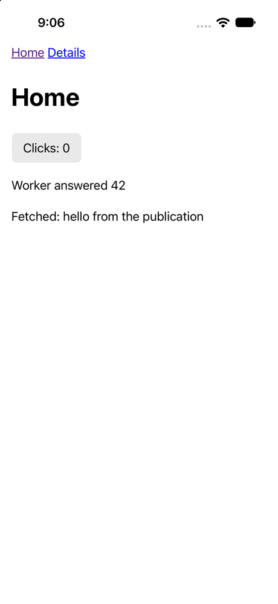

# hyperpane

Run [fusor](https://github.com/fusor-rs/fusor) applications as iPhone, iPad and
Mac apps.

fusor compiles HTML templates and Rust into a WebAssembly site. hyperpane takes
what `fusor build` publishes and shows it in Apple's WKWebView, in a window on
macOS and full screen on iOS, from one host program. Nothing in the application
changes: the same `dist/` that a web server would serve runs inside the app.

**Pre-alpha.** This is the first milestone: the host, a CLI, and the iOS
Simulator. Commands and options will change. Device builds, signing and App
Store delivery are not here yet.

<p align="center">
  
</p>

## What runs where

| | macOS | iOS Simulator | iOS device |
| --- | --- | --- | --- |
| Publication from `fusor build` | `hyperpane run dist` | `hyperpane run dist --ios` | not yet |
| Development server (`fusor dev`) | `hyperpane run --url …` | no | no |
| App bundle | no | `hyperpane bundle dist --ios --out …` | not yet |
| Threaded worker pools (`SharedArrayBuffer`) | yes, loopback origin | yes, loopback origin | not yet |

## Use it

hyperpane is not published yet. From a checkout of this repository, with Xcode
27 and the Rust iOS targets installed (`hyperpane doctor` checks them):

```sh
fusor build                                   # in your fusor application
cargo run -p hyperpane-cli -- run path/to/app/dist
cargo run -p hyperpane-cli -- run path/to/app/dist --ios --name "My App" --bundle-id com.example.myapp
cargo run -p hyperpane-cli -- run --url http://127.0.0.1:4173/
cargo run -p hyperpane-cli -- doctor
```

`run --ios` builds the host for the simulator, assembles `<name>.app`,
installs it in a booted iPhone simulator (or boots one) and relays the app's
output until it exits. `--simulator <name or UDID>` picks another device.

The CLI builds the host from the checkout it runs from; `--host-binary`
supplies one instead. Shipping a prebuilt host, so that applications need no
hyperpane checkout, is a later milestone.

Your application must be built for the base path `/`, and its HTML should say
how it uses the screen on iOS; see [docs/ios.md](docs/ios.md).

## How it works

- `hyperpane-host` opens a tao window and a wry web view. It serves the
  publication from the `hyperpane://localhost` scheme, exact paths only, or,
  when the publication uses shared-memory worker pools, from a loopback HTTP
  listener with the cross-origin isolation headers.
- Pages talk to the host with `window.ipc.postMessage`. Links to other web
  origins open in the system browser.
- The host writes one JSON line per event to standard output. The CLI and the
  tests read it.

[docs/consumption.md](docs/consumption.md) is the contract with fusor's output
and with the page; [docs/ios.md](docs/ios.md) covers the app bundle and the
simulator.

## Status and known limitations

- iOS runs in the simulator only. The bundle is unsigned and declares the
  simulator platform.
- `window.open` does nothing on iOS: wry 0.57 handles new-window requests only
  on macOS. Links with `target="_blank"` work on both platforms.
- The minimum iOS version is 17.0. fusor doesn't state the oldest WebKit it
  supports ([fusor#66](https://github.com/fusor-rs/fusor/issues/66)), and only
  iOS 27.0 and 27.1 simulators are tested.
- No menus, file dialogs, clipboard, notifications or other native features
  through the bridge yet.

## Contributing

See [CONTRIBUTING.md](CONTRIBUTING.md). hyperpane is MIT licensed.
