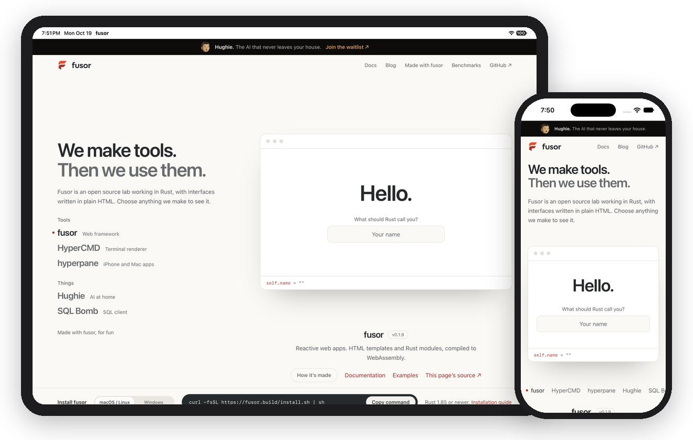

<p>
  <picture>
    <source media="(prefers-color-scheme: dark)" srcset="assets/brand/hyperpane-horizontal-dark.svg">
    
  </picture>
</p>

# Build iPhone, iPad and Mac apps with HTML and Rust

Write your app with fusor: HTML templates for the interface, Rust for state and logic. hyperpane turns it into an iPhone, iPad and Mac app. No Swift, no Xcode project, and no change to the app.

hyperpane is an app host for [fusor](https://github.com/fusor-rs/fusor). fusor compiles your HTML and Rust into WebAssembly; hyperpane packages that output with a small native host that shows it in Apple's WKWebView, full screen on iOS and in a window on macOS. The same `dist/` that a web server would serve runs inside the app.

**In development · v0.1**: this is experimental software. Commands will change, and iOS runs in the Simulator only for now. See [status and known limitations](#status-and-known-limitations).

[Get started](#get-started) · [How it works](#how-it-works) · [Documentation](#documentation) · [Status](#status-and-known-limitations) · [Contributing](CONTRIBUTING.md)

<p align="center">
  
</p>

## An app in one command

Any fusor application works as it is. In its directory:

```sh
hyperpane run --ios
```

hyperpane builds the application with fusor, assembles an iOS app around it, installs it in the iPhone Simulator, launches it and shows its events:

```text
▲ hyperpane 0.1.0 · iOS Simulator
○ Building my-app with fusor ...
✓ Built my-app in 4.2s
○ Building hyperpane-host for aarch64-apple-ios-sim ...
✓ Built hyperpane-host in 1.3s
○ Assembling My App.app ...
✓ Assembled My App.app in 7ms
○ Booting iPhone 17 (iOS 27.0) ...
✓ Booted iPhone 17 (iOS 27.0) in 94ms
○ Installing My App.app ...
✓ Installed My App.app in 673ms
✓ Launched My App on iPhone 17 (iOS 27.0)
- App:      com.example.myapp
- UDID:     1C6398AD-7E4D-4CE6-BE55-13ADAE994345
✓ Loaded hyperpane://localhost/
```

`hyperpane run` without `--ios` opens the same app in a Mac window. The picture above is fusor's own site, built by `fusor build` and run this way on an iPad and an iPhone.

## Get started

hyperpane runs on Macs with Apple silicon. It needs Xcode 27 with an iOS 27 Simulator runtime and the fusor CLI; `hyperpane doctor` checks them and prints the command that fixes each missing one. No release is published yet; until the first one, install from a checkout.

### Install a binary release

The installer downloads the latest GitHub release, verifies its SHA-256 checksum and installs `hyperpane` in `~/.hyperpane/bin`, with prebuilt hosts for the Mac and the iOS Simulator in `~/.hyperpane/hosts`. It needs no Rust toolchain:

```sh
curl -fsSL https://github.com/fusor-rs/hyperpane/releases/latest/download/install.sh | sh
export PATH="$HOME/.hyperpane/bin:$PATH"
```

Add the `export` line to your shell profile. To select a release, append `-s -- v0.1.0` to `sh`; `HYPERPANE_INSTALL` on the `sh` command chooses another directory.

### Install with Cargo

```sh
cargo install hyperpane-cli --locked
```

The first run for each platform installs the matching host, the `hyperpane-shell` crate at the same version, with Cargo into `~/.hyperpane/cache`. That needs the Rust target for it, such as `rustup target add aarch64-apple-ios-sim`.

### Install from a checkout

`cargo install --path crates/hyperpane-cli --locked` in this repository installs a CLI that builds its hosts from the checkout; see [CONTRIBUTING.md](CONTRIBUTING.md).

### Run your app

```sh
cd path/to/your-app
hyperpane run                         # build with fusor, show it in a macOS window
hyperpane run --ios --name "My App" --bundle-id com.example.myapp
hyperpane run --dist dist             # skip the build and show what fusor already wrote
hyperpane run --url http://127.0.0.1:4173/   # a running `fusor dev`
hyperpane bundle --ios --out build    # assemble the app without launching it
hyperpane doctor
```

`hyperpane run` finds the application's `Cargo.toml` the way Cargo does, or takes `--manifest-path`, runs `fusor build` on it and shows the directory fusor wrote. With `--ios` it installs the app in a booted iPhone simulator, or boots one, and shows the app's events until it exits; `--simulator <name or UDID>` picks another device. `FUSOR_BIN` selects a fusor CLI other than the one on `PATH`.

Your application must be built for the base path `/`, and its HTML should say how it uses the screen on iOS; see [the iOS guide](docs/ios.md).

### Upgrade

```sh
hyperpane upgrade
```

`upgrade` installs the latest release the way hyperpane was installed: with `install.sh` for a binary release, or with `cargo install` for a Cargo installation. It offers a release only once all of its files are published.

## How it works

- **Your app stays a fusor app.** hyperpane reads what `fusor build` publishes and adds nothing to it. The Rust compiles to WebAssembly exactly as for the web, so an app that runs in a browser runs in hyperpane.
- **One host, both platforms.** `hyperpane-host` opens a window and a WKWebView through the tao and wry crates: a window on macOS, the root view of an iOS app. The same binary runs on both.
- **Exact files, no server.** The host serves the app from a `hyperpane://localhost` scheme that only its own web view can reach: exact paths, the app's declared history fallback routes, and 404 for everything else.
- **Shared memory when the app needs it.** fusor's threaded worker pools need `SharedArrayBuffer`, which WebKit exposes only on an `http://` origin with the cross-origin isolation headers. For those apps the host serves from a small server on the device's own `127.0.0.1` instead.
- **Feels like an app.** No link previews, tap highlights or long-press callouts; links to other sites open in the system browser; if iOS ends the page's process in the background, the host reloads the current route.
- **No Xcode project.** The CLI assembles the `.app` bundle itself, with its `Info.plist`, and installs and launches it with `xcrun simctl`.
- **A contract you can read.** Pages talk to the host with `window.ipc.postMessage`; the host writes one JSON line per event. When the CLI's standard output is not a terminal, it passes those lines on for scripts.

## Documentation

| Guide | Covers |
| --- | --- |
| [The host's contract](docs/consumption.md) | What the host reads from fusor's output, how it serves it, the loopback rule, page messages and the JSON events |
| [iOS](docs/ios.md) | The app bundle, every `Info.plist` key, the simulator flow, how the app feels, and what your HTML must do |
| [Contributing](CONTRIBUTING.md) | Setup, checks, the fusor checkout the tests use, and releasing |

## Status and known limitations

hyperpane is v0.1 and experimental. Until 1.0, each minor release may change the commands and the host's contract.

### Platform status

| Platform or capability | Status |
| --- | --- |
| macOS window | CI gate |
| iPhone Simulator | CI gate, Xcode 27.1 |
| iPad Simulator | Manual runs |
| iPhone and iPad devices | Not yet: signing, provisioning and TestFlight come next |
| `fusor dev` in a window | macOS only |
| Threaded worker pools | Manual runs on macOS and in the iPhone Simulator |
| Mac Catalyst, visionOS | Not supported |

**Not supported yet:**

- Device builds, signing, App Store delivery and the widget extension. The simulator bundle is unsigned.
- `window.open` on iOS: wry 0.57 handles new-window requests only on macOS. Links with `target="_blank"` work on both platforms.
- Native features through the bridge: menus, file dialogs, clipboard, notifications, the keychain.
- A stated oldest iOS. hyperpane declares iOS 17.0 because fusor doesn't state the oldest WebKit it supports ([fusor#66](https://github.com/fusor-rs/fusor/issues/66)); only iOS 27 simulators are tested.

## How is this different from Tauri?

[Tauri](https://tauri.app) is a general framework for desktop and mobile apps with a web frontend and a Rust backend, built on the same tao and wry crates hyperpane uses. hyperpane does one thing: it runs what `fusor build` publishes, unchanged, with fusor's routing and worker rules built in, and assembles the iOS app itself instead of generating an Xcode project. Your application's logic stays in the fusor app.

## How is this different from Capacitor?

[Capacitor](https://capacitorjs.com) wraps a web app in native iOS and Android projects that you open and build in Xcode and Android Studio, with plugins written in Swift, Kotlin and JavaScript. hyperpane is a Rust host and CLI for fusor applications, with no native project to maintain, and it targets Apple platforms.

## Contributing

hyperpane is an open source project in early development. The [contributing guide](CONTRIBUTING.md) covers the setup, checks and workflow. The host lives in `crates/hyperpane-shell`, the `hyperpane` command in `crates/hyperpane-cli`, and the test application in `tests/consumer`.

hyperpane is built with the help of AI tools, mainly Claude Code, under the same rules the project asks of contributors: see [Using AI tools](CONTRIBUTING.md#using-ai-tools).

## License

hyperpane is licensed under the [MIT License](LICENSE).
